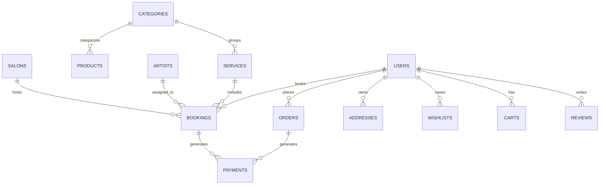

# Nihara D Aura — Database Schema Specification

This document details the MongoDB Mongoose schemas for all 15 collections required by the PRD.

---

## 1. Entity Relationship Overview



---

## 2. Collection Schemas

### 2.1 `User` (`users`)
```javascript
const UserSchema = new mongoose.Schema({
  name: { type: String, required: true, trim: true },
  email: { type: String, required: true, unique: true, lowercase: true, trim: true },
  phone: { type: String, required: true, unique: true, trim: true },
  password: { type: String, select: false }, // Hashed with bcryptjs
  avatar: { type: String, default: 'https://images.unsplash.com/photo-1507003211169-0a1dd7228f2d' },
  isPhoneVerified: { type: Boolean, default: false },
  isEmailVerified: { type: Boolean, default: false },
  defaultAddress: { type: mongoose.Schema.Types.ObjectId, ref: 'Address' },
  rewardPoints: { type: Number, default: 250 },
  membershipTier: { type: String, enum: ['Silver', 'Gold', 'Royal Elite'], default: 'Royal Elite' }
}, { timestamps: true });
```

### 2.2 `Category` (`categories`)
```javascript
const CategorySchema = new mongoose.Schema({
  name: { type: String, required: true, unique: true },
  slug: { type: String, required: true, unique: true },
  description: { type: String },
  bannerImage: { type: String },
  productCount: { type: Number, default: 0 },
  subcategories: [{ type: String }],
  isActive: { type: Boolean, default: true }
}, { timestamps: true });
```

### 2.3 `Product` (`products`)
```javascript
const ProductSchema = new mongoose.Schema({
  name: { type: String, required: true, trim: true },
  slug: { type: String, required: true, unique: true },
  tagline: { type: String },
  description: { type: String, required: true },
  category: { type: String, required: true }, // e.g. "Makeup", "Jewellery", "Nails", "Candles"
  subcategory: { type: String },
  price: { type: Number, required: true },
  originalPrice: { type: Number },
  discountPercent: { type: Number, default: 0 },
  images: [{ type: String, required: true }],
  stock: { type: Number, default: 50 },
  sku: { type: String, unique: true },
  rating: { type: Number, default: 4.8 },
  reviewCount: { type: Number, default: 0 },
  variants: [{
    name: { type: String }, // e.g. "Warm Ivory", "Golden Rose"
    sku: { type: String },
    priceAdjustment: { type: Number, default: 0 },
    inStock: { type: Boolean, default: true }
  }],
  sizes: [{ type: String }], // e.g. ["30 ml", "50 ml"]
  specifications: [{ key: String, value: String }],
  isFeatured: { type: Boolean, default: false },
  isBestseller: { type: Boolean, default: false },
  isActive: { type: Boolean, default: true }
}, { timestamps: true });
```

### 2.4 `Service` (`services`)
```javascript
const ServiceSchema = new mongoose.Schema({
  name: { type: String, required: true },
  slug: { type: String, required: true, unique: true },
  description: { type: String, required: true },
  category: { type: String, enum: ['Makeup', 'Nails', 'Hair', 'Jewellery & Styling'], required: true },
  image: { type: String, required: true },
  price: { type: Number, required: true },
  durationMinutes: { type: Number, required: true }, // e.g. 180, 90, 120
  rating: { type: Number, default: 4.9 },
  reviewCount: { type: Number, default: 0 },
  isSalonAvailable: { type: Boolean, default: true },
  isHomeAvailable: { type: Boolean, default: true },
  homeTravelCharge: { type: Number, default: 500 },
  inclusions: [{ type: String }],
  isActive: { type: Boolean, default: true }
}, { timestamps: true });
```

### 2.5 `Artist` (`artists`)
```javascript
const ArtistSchema = new mongoose.Schema({
  name: { type: String, required: true },
  title: { type: String, required: true }, // e.g. "Master Bridal Makeup Artist"
  specialization: [{ type: String }],
  rating: { type: Number, default: 4.9 },
  experienceYears: { type: Number, default: 8 },
  avatar: { type: String, required: true },
  isAvailable: { type: Boolean, default: true }
}, { timestamps: true });
```

### 2.6 `Salon` (`salons`)
```javascript
const SalonSchema = new mongoose.Schema({
  name: { type: String, required: true },
  address: { type: String, required: true },
  landmark: { type: String },
  city: { type: String, default: 'Mumbai' },
  state: { type: String, default: 'Maharashtra' },
  postalCode: { type: String, default: '400050' },
  phone: { type: String, default: '+91 98765 43210' },
  openingHours: { type: String, default: '09:00 AM - 08:30 PM' },
  isActive: { type: Boolean, default: true }
}, { timestamps: true });
```

### 2.7 `Booking` (`bookings`)
```javascript
const BookingSchema = new mongoose.Schema({
  bookingId: { type: String, unique: true, required: true }, // e.g. "BK-126697"
  user: { type: mongoose.Schema.Types.ObjectId, ref: 'User', required: true },
  services: [{
    service: { type: mongoose.Schema.Types.ObjectId, ref: 'Service' },
    name: { type: String, required: true },
    price: { type: Number, required: true },
    durationMinutes: { type: Number, required: true }
  }],
  artist: {
    artistId: { type: mongoose.Schema.Types.ObjectId, ref: 'Artist' },
    name: { type: String, default: 'Any Senior Specialist' }
  },
  locationType: { type: String, enum: ['salon', 'home'], required: true },
  salon: { type: mongoose.Schema.Types.ObjectId, ref: 'Salon' },
  serviceAddress: {
    fullName: String,
    phone: String,
    streetAddress: String,
    city: String,
    state: String,
    postalCode: String
  },
  date: { type: String, required: true }, // e.g. "2026-10-16"
  timeSlot: { type: String, required: true }, // e.g. "01:00 PM"
  servicesSubtotal: { type: Number, required: true },
  travelCharge: { type: Number, default: 0 },
  totalAmount: { type: Number, required: true },
  bookingStatus: {
    type: String,
    enum: ['Confirmed', 'Processing', 'Completed', 'Cancelled'],
    default: 'Confirmed'
  },
  paymentStatus: {
    type: String,
    enum: ['Paid', 'Pending', 'Refunded'],
    default: 'Paid'
  },
  notes: { type: String }
}, { timestamps: true });
```

### 2.8 `Order` (`orders`)
```javascript
const OrderSchema = new mongoose.Schema({
  orderId: { type: String, unique: true, required: true }, // e.g. "NIH-100172"
  user: { type: mongoose.Schema.Types.ObjectId, ref: 'User', required: true },
  items: [{
    product: { type: mongoose.Schema.Types.ObjectId, ref: 'Product' },
    name: { type: String, required: true },
    image: { type: String },
    variant: { type: String },
    size: { type: String },
    quantity: { type: Number, required: true, default: 1 },
    price: { type: Number, required: true }
  }],
  shippingAddress: {
    fullName: { type: String, required: true },
    phone: { type: String, required: true },
    streetAddress: { type: String, required: true },
    city: { type: String, required: true },
    state: { type: String, required: true },
    postalCode: { type: String, required: true }
  },
  paymentMethod: {
    type: String,
    enum: ['UPI', 'Credit/Debit Card', 'Net Banking', 'Cash on Delivery'],
    default: 'UPI'
  },
  subtotal: { type: Number, required: true },
  discount: { type: Number, default: 0 },
  couponApplied: { type: String },
  deliveryFee: { type: Number, default: 0 },
  totalAmount: { type: Number, required: true },
  orderStatus: {
    type: String,
    enum: ['Processing', 'Packed', 'Shipped', 'Delivered', 'Cancelled'],
    default: 'Processing'
  },
  paymentStatus: {
    type: String,
    enum: ['Paid', 'Pending', 'Failed', 'Refunded'],
    default: 'Paid'
  },
  paymentId: { type: String }
}, { timestamps: true });
```

### 2.9 `Address` (`addresses`)
```javascript
const AddressSchema = new mongoose.Schema({
  user: { type: mongoose.Schema.Types.ObjectId, ref: 'User', required: true },
  type: { type: String, enum: ['Home', 'Office', 'Other'], default: 'Home' },
  isDefault: { type: Boolean, default: false },
  fullName: { type: String, required: true },
  phone: { type: String, required: true },
  streetAddress: { type: String, required: true },
  city: { type: String, required: true },
  state: { type: String, required: true },
  postalCode: { type: String, required: true }
}, { timestamps: true });
```

### 2.10 `Cart` (`carts`) & `Wishlist` (`wishlists`)
```javascript
const CartSchema = new mongoose.Schema({
  user: { type: mongoose.Schema.Types.ObjectId, ref: 'User', required: true, unique: true },
  items: [{
    product: { type: mongoose.Schema.Types.ObjectId, ref: 'Product' },
    quantity: { type: Number, default: 1 },
    variant: String,
    size: String
  }],
  appliedCoupon: { type: String }
}, { timestamps: true });

const WishlistSchema = new mongoose.Schema({
  user: { type: mongoose.Schema.Types.ObjectId, ref: 'User', required: true, unique: true },
  products: [{ type: mongoose.Schema.Types.ObjectId, ref: 'Product' }]
}, { timestamps: true });
```

### 2.11 `Coupon` (`coupons`) & `OTPVerification` (`otpVerifications`)
```javascript
const CouponSchema = new mongoose.Schema({
  code: { type: String, unique: true, uppercase: true, required: true },
  discountType: { type: String, enum: ['percent', 'fixed'], default: 'percent' },
  discountValue: { type: Number, required: true }, // e.g. 10 for 10%
  minimumOrder: { type: Number, default: 0 },
  maxDiscount: { type: Number },
  expiresAt: { type: Date },
  isActive: { type: Boolean, default: true }
}, { timestamps: true });

const OTPVerificationSchema = new mongoose.Schema({
  identifier: { type: String, required: true }, // phone or email
  otpCode: { type: String, required: true },
  expiresAt: { type: Date, required: true, index: { expires: 0 } }, // Auto TTL removal
  isUsed: { type: Boolean, default: false }
}, { timestamps: true });
```
