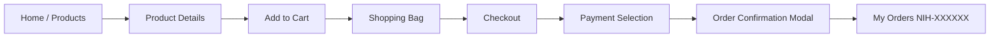
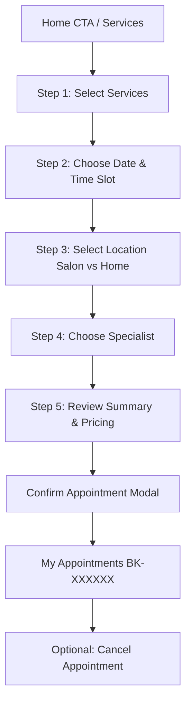
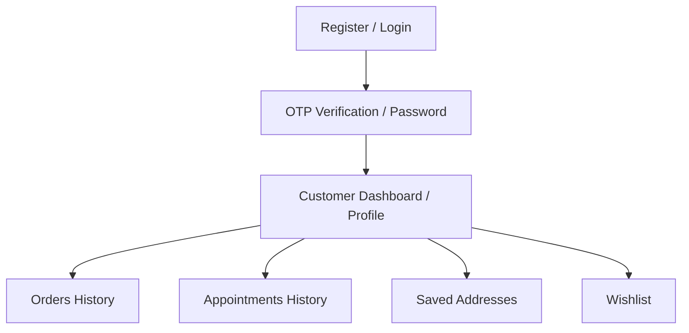

# Nihara D Aura — Web Site Map & Route Hierarchy

This document outlines the complete information architecture, page routing, query parameters, access control levels, and page layouts for the Nihara D Aura customer-facing web platform.

---

## 1. Route Table & Access Controls

| Route Path | Page Component | Access Level | Description | Key Query Params |
|---|---|---|---|---|
| `/` | `Home.jsx` | Public | Luxury homepage with hero banner, category pills, bestsellers, featured luxuries, signature salon services & booking banner. | None |
| `/products` | `Products.jsx` | Public | Full product catalogue with search, category filters, price slider, ratings filter, and sorting. | `?category=...&sort=...&search=...&page=...` |
| `/products/:id` | `ProductDetails.jsx` | Public | Individual luxury product page with image gallery, variant/size selectors, ingredients, and related items. | None |
| `/categories` | `Categories.jsx` | Public | Rich category cards showcasing 4 main beauty verticals with subcategory tags. | None |
| `/categories/:slug` | `CategoryProducts.jsx` | Public | Curated listing of products belonging to a specific vertical or subcategory. | `?sub=...&sort=...` |
| `/services` | `Services.jsx` | Public | Signature salon and at-home beauty services catalogue with filter by beauty domain. | `?category=...` |
| `/services/:id` | `ServiceDetails.jsx` | Public | Service breakdown with duration, inclusions, specialist options, and direct booking trigger. | None |
| `/book` | `BookingWizard.jsx` | Customer / Guest | 5-step multi-step beauty booking flow (Services → Date/Time → Location → Specialist → Summary/Payment). | `?serviceId=...` |
| `/cart` | `Cart.jsx` | Public / Customer | Luxury shopping bag with item counters, promo code discounts (`NIHARA10`, `GLOW20`), and price totals. | None |
| `/checkout` | `Checkout.jsx` | Customer (Auth/Guest) | Delivery address selector, payment gateway options (UPI, Card, NetBanking, COD), order preview, and order confirmation. | None |
| `/wishlist` | `Wishlist.jsx` | Customer | Saved luxury beauty and jewellery items with 1-click move to bag. | None |
| `/profile` | `Profile.jsx` | Customer (Protected) | Account dashboard with user info, order stats, address management, and quick navigation. | None |
| `/profile/edit` | `EditProfileModal.jsx` | Customer (Protected) | Profile editor for name, email, phone, and avatar selector. | None |
| `/orders` | `Orders.jsx` | Customer (Protected) | Purchase history with status tracking (`Processing`, `Shipped`, `Delivered`, `Cancelled`). | `?status=...` |
| `/orders/:id` | `OrderDetails.jsx` | Customer (Protected) | Detailed invoice view for a specific order with items, shipping address, and tracking status. | None |
| `/bookings` | `Bookings.jsx` | Customer (Protected) | "My Appointments" screen showing upcoming and past salon & at-home bookings with cancellation options. | `?filter=upcoming|past` |
| `/bookings/:id` | `BookingDetails.jsx` | Customer (Protected) | Deep dive into a specific appointment with specialist info, venue/address, and timing. | None |
| `/addresses` | `Addresses.jsx` | Customer (Protected) | Management of saved delivery and service addresses (Add, Edit, Set as Default, Remove). | None |
| `/login` | `Login.jsx` | Public (Unauthenticated) | Customer login with email/phone and password or OTP. | `?redirect=...` |
| `/register` | `Register.jsx` | Public (Unauthenticated) | Account creation for new patrons. | None |
| `/verify-otp` | `VerifyOTP.jsx` | Public (Unauthenticated) | 6-digit OTP verification screen with resend timer. | `?phone=...&purpose=...` |

> [!CAUTION]
> **Strict PRD Constraint**: There is NO `/admin` route or administrative panel. Any administration tasks are explicitly omitted per requirements.

---

## 2. Navigation Hierarchy & User Journeys

### 2.1 E-Commerce Shopping Flow

### 2.2 Luxury Salon & At-Home Booking Flow

### 2.3 Customer Account & Authentication Flow

